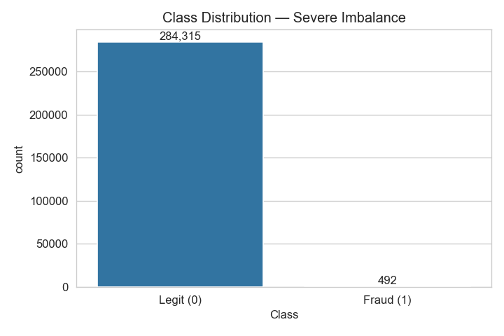

# 💳 Credit Card Fraud Detection

A machine learning project that detects fraudulent credit card transactions
in a highly imbalanced dataset (0.17% fraud), with a deployed interactive
Streamlit app for live predictions.

**🔗 Live demo:** _add your Streamlit Cloud link here after deploying_



## Problem

Detect fraudulent transactions from ~285,000 anonymized European credit
card transactions, where only 492 (0.17%) are fraud. The severe imbalance
means naive accuracy is meaningless — a model that always predicts "not
fraud" scores 99.83% accuracy while catching nothing.

## Dataset

[Credit Card Fraud Detection (ULB)](https://www.kaggle.com/datasets/mlg-ulb/creditcardfraud)
on Kaggle — 284,807 transactions from European cardholders over two days.
Features `V1`–`V28` are PCA-anonymized (standard practice for real
financial data); `Time` and `Amount` are the only interpretable raw features.

## Approach

1. **EDA** — class imbalance, amount distribution, feature correlation with fraud
2. **Preprocessing** — scaled `Amount`/`Time`, stratified train/test split
3. **Imbalance handling** — compared two strategies:
   - Class weighting (`class_weight='balanced'`)
   - SMOTE oversampling (training set only — never applied to test data)
4. **Models compared** — Logistic Regression (baseline), Random Forest, XGBoost
5. **Evaluation** — Precision, Recall, F1, ROC-AUC, and **PR-AUC** (the most
   informative metric on this imbalanced dataset)

## Results

| Model | Precision | Recall | F1 | PR-AUC |
|---|---|---|---|---|
| Logistic Regression | _fill in_ | _fill in_ | _fill in_ | _fill in_ |
| Random Forest | _fill in_ | _fill in_ | _fill in_ | _fill in_ |
| XGBoost | _fill in_ | _fill in_ | _fill in_ | _fill in_ |
| XGBoost + SMOTE | _fill in_ | _fill in_ | _fill in_ | _fill in_ |

_(Fill this in after running the notebook — see `STEPS.md`.)_

**Key decision:** in fraud detection, a missed fraud case (false negative)
is usually more costly than a false alarm (false positive), so the final
model was selected with a lean toward higher recall rather than raw accuracy.

## Try it

The Streamlit app lets you:
- Enter transaction values manually or load a random real transaction
- See the fraud probability and an adjustable decision threshold, so you
  can see the precision/recall tradeoff in real time
- View the EDA charts and explanation of why accuracy is misleading here

## Run locally

```bash
git clone <your-repo-url>
cd fraud-detection
pip install -r requirements.txt

# Download creditcard.csv from Kaggle into data/

python src/train.py          # trains models, saves the best one
streamlit run app.py         # launches the app at localhost:8501
```

Full beginner-friendly walkthrough: see [`STEPS.md`](STEPS.md).

## Project structure

```
fraud-detection/
├── data/                   # creditcard.csv goes here (not in git — see .gitignore)
├── notebooks/
│   └── 01_eda_and_modeling.ipynb
├── src/
│   ├── preprocess.py       # loading, scaling, splitting, SMOTE
│   ├── train.py            # trains and compares 3 models
│   └── evaluate.py         # precision/recall/F1/PR-AUC evaluation
├── models/                 # saved model + charts (generated, not in git)
├── app.py                  # Streamlit app
├── requirements.txt
└── STEPS.md                # full beginner walkthrough
```

## Stretch goals (not yet implemented)

- SHAP values in the app to explain individual predictions ("why was this flagged?")
- Threshold-tuning visualization built directly into the notebook
