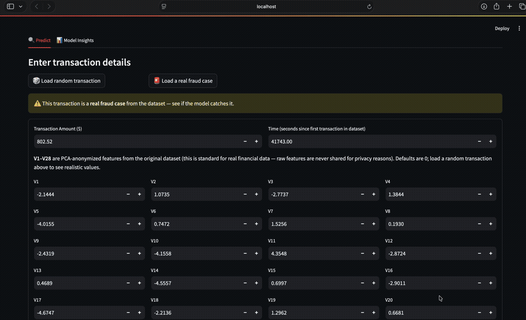

# Credit Card Fraud Detection

Built a machine learning pipeline to detect fraudulent credit card transactions from a heavily imbalanced dataset — only 0.17% of transactions are actual fraud.

**Live demo:** _coming soon_



---

## The problem

The dataset has 284,807 transactions, of which only 492 are fraud. That imbalance is the entire challenge. A model that just guesses "not fraud" every single time would be 99.83% accurate — and completely useless. So raw accuracy means nothing here. I focused on PR-AUC and recall instead.

The features are mostly anonymized (V1–V28 are PCA components — standard practice in financial data to protect cardholder privacy). The only raw features are `Amount` and `Time`.

Dataset: [Credit Card Fraud Detection on Kaggle (ULB)](https://www.kaggle.com/datasets/mlg-ulb/creditcardfraud)

---

## What I did

- Explored the data: class imbalance, transaction amount distribution, which features correlate most strongly with fraud
- Scaled `Amount` and `Time`, then did a stratified train/test split so fraud cases are evenly distributed
- Used SMOTE to oversample fraud cases in the **training set only** — applying it before splitting would leak synthetic fraud into the test set, which inflates scores unfairly
- Trained three models and compared them: Logistic Regression (baseline), Random Forest, XGBoost
- Picked the winner based on PR-AUC, which is the most informative metric on imbalanced data

---

## Results

| Model | Precision | Recall | F1 | PR-AUC |
|---|---|---|---|---|
| Logistic Regression | 0.06 | 0.92 | 0.11 | 0.72 |
| Random Forest | 0.96 | 0.76 | 0.85 | 0.86 |
| **XGBoost** | **0.87** | **0.85** | **0.86** | **0.88** |

XGBoost won. It catches 85% of actual fraud cases while keeping false alarms low. Logistic Regression catches more fraud (92% recall) but flags way too many legit transactions — in practice that'd be thousands of unnecessary card declines per day. Random Forest is precise but misses too much fraud. XGBoost hits the right balance.

In fraud detection, missing a real fraud case is generally worse than a false alarm, so I'd lean the threshold slightly toward recall in production — the app lets you see this tradeoff live.

---

## The app

Built a Streamlit app to make the model actually usable:

- Load a random real transaction from the dataset and run it through the model
- See the fraud probability score
- Adjust the decision threshold with a slider and watch how precision/recall shift in real time

To run it locally:

```bash
git clone <your-repo-url>
cd fraud-detection

python3 -m venv venv
source venv/bin/activate
pip install -r requirements.txt

# put creditcard.csv in data/ (download from Kaggle link above)
python src/train.py       # trains models, saves the best one
streamlit run app.py      # opens at localhost:8501
```

---

## Project structure

```
├── data/                   # creditcard.csv goes here (not committed — too large)
├── notebooks/
│   └── 01_eda_and_modeling.ipynb
├── src/
│   ├── preprocess.py       # data loading, scaling, train/test split, SMOTE
│   ├── train.py            # trains all 3 models, picks the best, saves it
│   └── evaluate.py         # scoring: precision, recall, F1, PR-AUC
├── models/                 # saved model file + charts (auto-generated)
├── app.py                  # Streamlit app
└── requirements.txt
```

---

## What I'd improve

The most obvious next step is adding SHAP explanations — right now the app tells you *that* a transaction is suspicious but not *why*. SHAP would surface which features pushed the score up, which is actually useful in a real fraud review workflow. I'd also try threshold-tuning directly in the notebook rather than just in the app.
